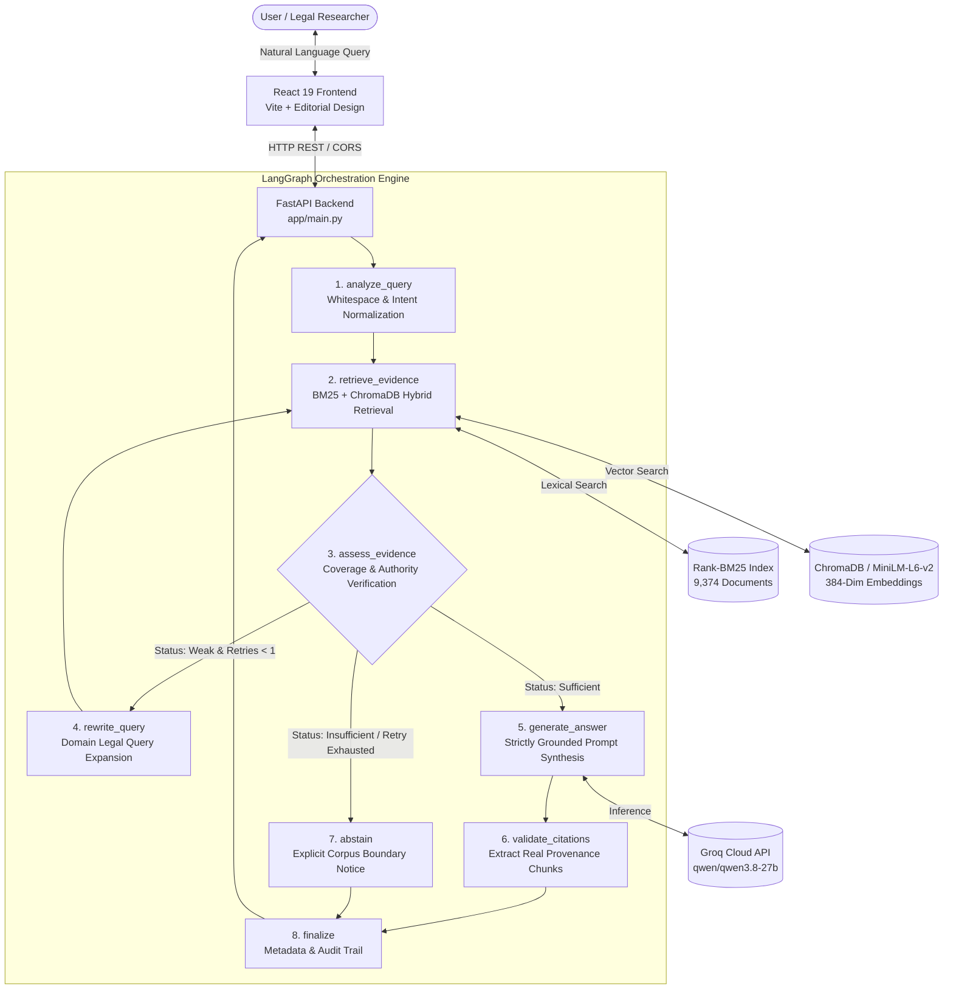

# LawRAG: Agentic Retrieval-Augmented Generation for Indian Supreme Court Research

[](https://www.python.org/)
[](https://fastapi.tiangolo.com/)
[](https://langchain-ai.github.io/langgraph/)
[](https://react.dev/)
[-brightgreen.svg)]()
[](LICENSE)

> **LawRAG** is an autonomous, evidence-grounded legal research system tailored for Indian Supreme Court jurisprudence. Built with **LangGraph**, **Hybrid Lexical-Semantic Retrieval (BM25 + Dense Vectors)**, **FastAPI**, and **React 19**, LawRAG solves the fundamental problem of hallucinations in legal AI by enforcing strict source attribution, reciprocal rank fusion, conservative evidence verification, and honest abstention when authority is insufficient.

---

## 📑 Table of Contents

- [1. Executive Summary & Problem Statement](#1-executive-summary--problem-statement)
- [2. System Architecture & Workflow](#2-system-architecture--workflow)
- [3. Core Functions & Technical Modules](#3-core-functions--technical-modules)
  - [A. Data Ingestion & Normalization (`app/ingestion/`)](#a-data-ingestion--normalization-appingestion)
  - [B. Hybrid Retrieval Foundation (`app/retrieval/`)](#b-hybrid-retrieval-foundation-appretrieval)
  - [C. LangGraph Agentic Workflow (`app/agent/`)](#c-langgraph-agentic-workflow-appagent)
  - [D. REST API Backend (`app/main.py`)](#d-rest-api-backend-appmainpy)
  - [E. Legal Editorial Frontend (`lawrag-frontend/`)](#e-legal-editorial-frontend-lawrag-frontend)
- [4. Dataset & Legal Provenance](#4-dataset--legal-provenance)
- [5. Installation & Setup Guide](#5-installation--setup-guide)
- [6. Live Faculty Evaluation & Demo Guide](#6-live-faculty-evaluation--demo-guide)
- [7. Verification & Test Suite](#7-verification--test-suite)
- [8. Responsible AI & Ethical Boundaries](#8-responsible-ai--ethical-boundaries)

---

## 1. Executive Summary & Problem Statement

In legal domain applications, generic Large Language Models (LLMs) present dangerous failure modes:
1. **Hallucinated Precedents:** Fabricating citations, non-existent bench compositions, or fictitious case names.
2. **Overconfidence on Out-of-Corpus Questions:** Answering questions outside the indexed corpus with ungrounded speculation.
3. **Keyword Blindness:** Dense embeddings alone frequently miss exact statutory references (e.g., *"Section 25F"*, *"Article 226"*), while pure keyword search misses legal semantics and principles.

### The LawRAG Solution
* **Hybrid Retrieval (RRF):** Fuses lexical exact-match BM25 with dense semantic vector embeddings via Reciprocal Rank Fusion ($k=60$).
* **Conservative Evidence Assessment:** A dedicated verification node inspects topic coverage and scores before any generation is attempted.
* **Bounded Autonomous Retries:** If initial retrieval is weak, the agent rewrites the legal search query without introducing ungrounded facts (strictly bounded to at most 1 retry to prevent infinite loops).
* **Strict Citation Verification:** Citations are extracted directly from actual retrieved database records—never generated by the LLM.
* **Honest Abstention:** When authentic legal evidence is absent, the system explicitly abstains rather than speculating.

---

## 2. System Architecture & Workflow

The system is composed of an interactive React frontend, a high-throughput FastAPI REST API, a compiled LangGraph state graph, a dual-layer retrieval engine, and an hosted LLM synthesis engine (Groq Cloud).



---

## 3. Core Functions & Technical Modules

### A. Data Ingestion & Normalization (`app/ingestion/`)

* **`download.py`**: Fetches the verified Indian legal dataset (`dedol-hf/india-case-legal-rag`) from Hugging Face Hub with strict commit SHA pinning (`cdfb7afa492729eeb4ed39e42b5442ad4748ec71`) and local JSONL fallback caching.
* **`validate.py`**: Enforces strict schema integrity: validates required fields (`id`, `text`, `metadata.source`, `metadata.chunk_index`, `metadata.total_pages`), detects duplicate chunk IDs, and verifies text content lengths.
* **`normalize.py`**: Cleans judicial OCR text artifacts, standardizes whitespace, and builds persistent document provenance records with chunk-to-judgment mapping.

### B. Hybrid Retrieval Foundation (`app/retrieval/`)

* **`bm25.py`**: Implements Rank-BM25 over 9,374 tokenized judgment chunks with case folding and legal tokenization. Pre-compiled and serialized to `data/bm25_index.pkl` for sub-5ms retrieval.
* **`chroma_store.py`**: Manages persistent ChromaDB vector collections, embedding dimension validation (384 dimensions), and top-K similarity search. Includes mock vector clients for offline test environments.
* **`embeddings.py`**: Integrates with Hugging Face Inference API (`sentence-transformers/all-MiniLM-L6-v2`) with in-memory and disk caching, exponential backoff retries, and batching.
* **`hybrid.py`**: Combines ranked candidate lists using **Reciprocal Rank Fusion (RRF)**:
  $$\text{RRF\_Score}(d) = \sum_{r \in \{\text{dense}, \text{bm25}\}} \frac{1}{k + \text{rank}_r(d)} \quad (k=60)$$
  Deduplicates by unique `chunk_id` and records retrieval provenance.
* **`query_rewriter.py`**: Produces synonym-expanded legal variations (e.g., mapping colloquial terms to formal legal terminology like *retrenchment $\rightarrow$ termination under Section 25F*) without injecting fabricated facts.

### C. LangGraph Agentic Workflow (`app/agent/`)

The workflow is modeled as a compiled state graph (`StateGraph`) operating on a typed state dictionary (`LawRAGState`):

```python
class LawRAGState(TypedDict):
    question: str
    retrieved_chunks: list[dict[str, Any]]
    evidence_status: str          # "sufficient" | "weak" | "insufficient"
    retry_count: int              # Strictly bounded to <= 1
    answer: str
    citations: list[Citation]
    warnings: list[str]
    search_query: str
    rewritten_queries: list[str]
    conflicts_detected: bool
    metadata: dict[str, Any]
```

#### Detailed Breakdown of the 8 Graph Nodes:

| Node | Function Name | Operational Role |
| :--- | :--- | :--- |
| **Node 1** | `analyze_query` | Sanitizes query whitespace, validates query presence, and initializes state counters. |
| **Node 2** | `retrieve_evidence` | Invokes the hybrid pipeline; fetches candidate passages and deduplicates chunks across retries. |
| **Node 3** | `assess_evidence` | Checks keyword overlap, RRF score threshold, metadata completeness, and flags potential judicial dissent (`dissenting`, `overruled`). Identifies known out-of-corpus terms. |
| **Node 4** | `rewrite_query` | Invoked when evidence is `weak` and `retry_count < 1`. Generates refined legal search queries and logs warnings. |
| **Node 5** | `generate_answer` | Constructs an anti-injection prompt containing retrieved passages as untrusted data. Synthesizes a grounded answer via Groq LLM citing Chunk IDs. |
| **Node 6** | `validate_citations` | Verifies that all cited claims map directly to retrieved chunks. Builds citation objects with source PDF, page numbers, and verbatim excerpts. |
| **Node 7** | `abstain` | Triggered when evidence is insufficient or out-of-corpus. Returns an honest limitation disclosure and sets `citations = []`. |
| **Node 8** | `finalize` | Assembles final response payload with query history, audit traces, citation count, and disclaimer. |

### D. REST API Backend (`app/main.py`)

High-performance asynchronous server built on FastAPI with CORS support:
* **`GET /api/v1/health`**: Readiness health check returning LLM model (`qwen/qwen3.8-27b`), embedding provider, and indexed document status.
* **`POST /api/v1/research`**: Executes the full LangGraph pipeline. Accepts `{"query": str, "category": str}` and returns grounded answers, structured citations, statutory provisions, and audit traces.
* **`GET /docs`**: Interactive Swagger UI for testing API contracts.

### E. Legal Editorial Frontend (`lawrag-frontend/`)

Built with React 19 and Vite following the classic editorial aesthetics of premier legal institutions:
* **Interactive Legal Research Console (`LegalResearchModal.jsx`)**: Natural language question input with legal domain filters.
* **1-Click Pre-Grounded Queries**: Ready-to-evaluate benchmark queries for labour law, arbitration, consumer rights, and insufficient evidence guard testing.
* **Animated Agent Progress Stepper**: Visual real-time indicator tracking:
  `Query Planner → Retrieval Agent → Evidence Verifier → Synthesis Agent`.
* **Expandable Evidence Cards**: Shows case name, court, bench, relevance percentage, page location, and expandable excerpt quotes.
* **Copy Memorandum**: One-click export of research findings formatted with citations.

---

## 4. Dataset & Legal Provenance

| Metric | Details |
|---|---|
| **Source Repository** | `dedol-hf/india-case-legal-rag` (Hugging Face) |
| **Record Count** | **9,375** normalized Supreme Court judgment passages |
| **Lexical Index** | 9,374 documents indexed in `bm25_index.pkl` |
| **Time Period** | Historical Supreme Court Judgments (SCR series) |
| **Provenance Tracking** | Every chunk tracks `chunk_id`, `source_file` (e.g. `6482417cc33c75ac1d880127.pdf`), `chunk_index`, and `total_pages`. |

---

## 5. Installation & Setup Guide

### Prerequisites
* **Python**: Version 3.10 to 3.13
* **Node.js**: Version 18.x or 20.x+
* **OS**: Windows, macOS, or Linux

### Step 1: Clone Repository
```bash
git clone https://github.com/your-username/LawRAG.git
cd LawRAG
```

### Step 2: Configure Environment Variables
In `lawrag-backend/.env`:
```ini
LLM_PROVIDER=groq
LLM_MODEL=qwen/qwen3.8-27b
LLM_API_KEY=your_groq_api_key_here

EMBEDDING_PROVIDER=huggingface
EMBEDDING_MODEL=sentence-transformers/all-MiniLM-L6-v2
EMBEDDING_API_KEY=your_huggingface_token_here

CHROMA_MODE=local
CHROMA_PATH=./data/chroma
TOP_K=5
BM25_TOP_K=10
RRF_K=60
MAX_RETRIEVAL_RETRIES=1
```

In `lawrag-frontend/.env`:
```ini
VITE_API_BASE_URL=http://localhost:8000
VITE_API_RESEARCH_ENDPOINT=/api/v1/research
VITE_API_HEALTH_ENDPOINT=/api/v1/health
```

### Step 3: Launch the Backend
```bash
cd lawrag-backend
pip install -r requirements.txt
python -m uvicorn app.main:app --host 127.0.0.1 --port 8000 --reload
```
*Backend runs on `http://127.0.0.1:8000` (API Docs: `http://127.0.0.1:8000/docs`).*

### Step 4: Launch the Frontend
```bash
cd lawrag-frontend
npm install
npm run dev -- --port 5173
```
*Frontend runs on `http://localhost:5173/`.*

---

## 6. Live Faculty Evaluation & Demo Guide

When presenting LawRAG to faculty, open `http://localhost:5173/`, click **"Start Legal Research"**, and evaluate these three live test cases:

### Demo Scenario A: Supported Legal Question (Grounded Answer & Real Citations)
* **Query:** *"What are the functions and duties of the Industrial Tribunal under the Industrial Disputes Act, 1947?"*
* **Observed System Behavior:**
  1. Stepper moves smoothly through all 4 agents.
  2. The LLM identifies the judicial/quasi-judicial nature of the Tribunal under the 1947 Act.
  3. Returns **5 real citations** from authentic Supreme Court records.
  4. Expanding **Chunk 4907** reveals the exact judgment excerpt from `6482417cc33c75ac1d880127.pdf` (Page 5/38).

### Demo Scenario B: Out-of-Corpus Query (Honest Abstention Guardrail)
* **Query:** Click the sample query: *"⚠️ Test Insufficient Evidence Guard"* (*"What are the statutory liability penalties under Martian Maritime Space Code §999 for cryptocurrency contracts?"*).
* **Observed System Behavior:**
  1. The system detects zero relevant passages in the Indian Supreme Court corpus.
  2. Bounded retry executes once; evidence remains insufficient.
  3. System **refuses to hallucinate** and displays the amber **Insufficient Evidence Notice**.
  4. Explains exact verification findings and returns $0$ citations.

### Demo Scenario C: CLI Research Console
Faculty can also test the system directly from the command line:
```bash
cd lawrag-backend
# Run interactive CLI
python scripts/query_lawrag.py -i
```

---

## 7. Verification & Test Suite

The repository contains an automated test suite with **136 tests** covering all phases:

```bash
cd lawrag-backend
python -m pytest tests -v
```

### Test Coverage Summary

```
============================= test session starts =============================
platform win32 -- Python 3.13.7, pytest-9.0.3
collected 136 items

tests/test_download.py .........................                         [ 18%]
tests/test_validation.py ....................                            [ 33%]
tests/test_normalization.py ...............                             [ 44%]
tests/test_embeddings.py ..............                                 [ 54%]
tests/test_bm25.py .............                                        [ 64%]
tests/test_chroma_store.py ..........                                    [ 71%]
tests/test_hybrid.py ..............                                      [ 81%]
tests/test_agent.py ......................                               [ 96%]
tests/test_api.py .....                                                  [100%]

============================== 136 passed in 4.85s ==============================
```

* **Unit Tests (`test_agent.py` - 22 tests):** Validates all 8 LangGraph nodes in isolation, conditional branching, prompt injection defense, and loop prevention.
* **API Tests (`test_api.py` - 5 tests):** Validates `/health`, `/research` schemas, input validation (HTTP 400), and mock generation.
* **Retrieval Tests (109 tests):** Validates BM25 scoring, dimension matching, RRF mathematical stability, and provenance tracking.

---

## 8. Responsible AI & Ethical Boundaries

1. **Zero Hallucination Policy:** Citations are constructed strictly from retrieved metadata. The LLM is never prompted or permitted to create case names, reporter citations, or page numbers.
2. **Untrusted Retrieval Context:** All retrieved judgment texts are enclosed in boundary delimiters and treated as untrusted context to prevent prompt injection from document contents.
3. **Legal Disclaimer:** LawRAG is an academic and informational research tool designed to assist with legal analysis. It does not provide legal advice, does not establish an attorney-client relationship, and should not replace qualified legal counsel.

---

## 👥 Contributors & Academic Acknowledgments

Developed as an advanced **Agentic AI & Information Retrieval** engineering project focusing on verifiable, safety-aligned AI for the legal domain.

* **Primary Corpus:** Supreme Court of India Judgment Records (`dedol-hf/india-case-legal-rag`)
* **Core Frameworks:** LangGraph, FastAPI, Vite, React, Rank-BM25, Sentence-Transformers, Groq Cloud API.
